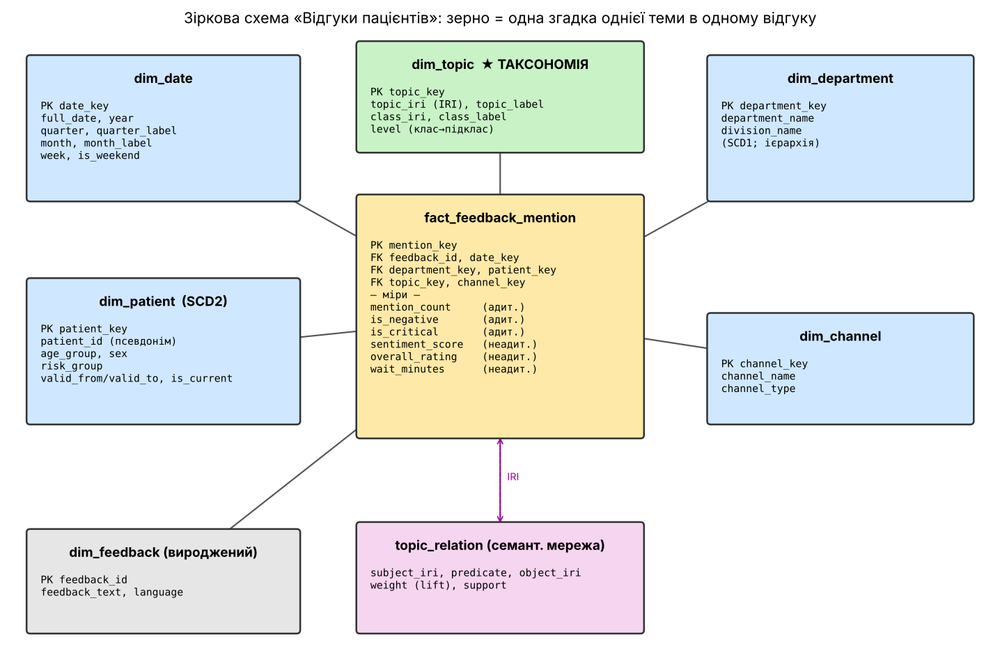
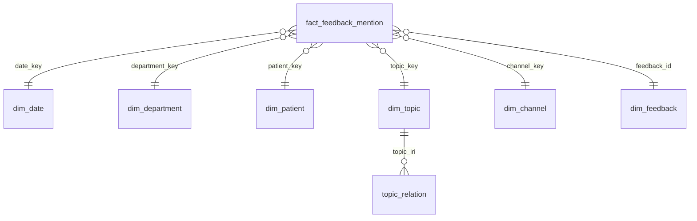

# Результат 1. Зерно, питання та схема

**Предметна область:** медицина · моніторинг стану пацієнтів · знання з відгуків пацієнтів · моделі відгуків на основі семантичної мережі.
**Артефакти:** `docs/star_design.md`, `sql/ddl.sql`, `docs/star_schema.png`.

## 1. Бізнес-процес і зерно факту

**Бізнес-процес:** збір і аналіз відгуків пацієнтів про лікування та перебування в закладі (опитування при виписці, SMS, портал пацієнта, кіоск, гаряча лінія).

**Зерно факту (grain):** *один рядок = одна згадка однієї теми (підкласу таксономії) в одному відгуку пацієнта.*
Відгук із трьома темами дає три рядки факту. Зерно визначено першим, бо від нього залежать, які виміри можна приєднати, що означає кожна міра і чи коректно агрегувати (наприклад, `COUNT(*)` — це згадки, а не відгуки).

## 2. Бізнес-питання (≥ 5)

1. Які класи й підкласи тем (за таксономією) мають найбільшу частку негативних згадок?
2. Як змінюється частка негативу та тональність у часі (місяць, квартал, рік)?
3. У яких відділеннях/підрозділах проблеми з очікуванням і моніторингом стану найгостріші?
4. Чи збільшився час очікування в невідкладній допомозі та поліклініці?
5. Скільки критичних згадок (безпека ліків, реагування на сигнали тривоги) накопичується і чи зростає темп?
6. Які теми згадуються разом (семантична мережа) і які комплексні проблеми з цього випливають?
7. Чи відрізняється тональність пацієнтів різних груп ризику?

## 3. Виміри (5 + вироджений) і міри

| Вимір | Ключ | Атрибути | Ієрархія | SCD |
|---|---|---|---|---|
| `dim_date` | `date_key` (YYYYMMDD) | дата, рік, квартал, місяць, тиждень | рік → квартал → місяць → дата | — (незмінний) |
| `dim_department` | `department_key` | відділення, підрозділ | підрозділ → відділення | тип 1 |
| `dim_patient` | `patient_key` (сурогат) | псевдонім, вік. група, стать, **група ризику**, valid_from/to | — | **тип 2** (група ризику) |
| **`dim_topic`** ★ | `topic_key` | **`topic_iri`**, підклас, **`class_iri`**, клас, рівень | корінь Feedback → **клас → підклас** | тип 1 |
| `dim_channel` | `channel_key` | канал, тип (активний/пасивний) | — | тип 1 |
| `dim_feedback` | `feedback_id` | текст відгуку, мова | — (вироджений) | — |

★ **Таксономія як вимір (IRI):** `dim_topic` — це листки таксономії (підкласи), кожен має IRI виду
`https://hub.lnu.edu.ua/onto/patient-feedback#EmergencyWait` та IRI батьківського класу. Ієрархія *клас → підклас* дає drill-down/roll-up.
Зв'язки між темами (`rdfs:subClassOf`, `fb:coOccursWith`) зберігаються в `topic_relation` і в `data/feedback_semantic_network.ttl` — це семантична мережа, на якій будуються моделі відгуків.

> Примітка: таксономію з ЛР5 замінено навчальною (6 класів, 20 підкласів). Якщо у вас є власна таксономія з ЛР5 — замініть `TAXONOMY` у `etl/generate_data.py` (коди й IRI).

### Класифікація мір

| Міра | Тип | Пояснення |
|---|---|---|
| `mention_count` (=1) | **адитивна** | можна сумувати за всіма вимірами |
| `is_negative` | **адитивна** | кількість негативних згадок; сумується |
| `is_critical` | **адитивна** | кількість критичних згадок |
| `sentiment_score` | **неадитивна** | шкала [-1;1]; агрегується лише через AVG, суми не мають змісту |
| `overall_rating` | **неадитивна** | оцінка відгуку (1–5), повторюється для кожної його згадки; лише AVG, зважене кількістю тем |
| `wait_minutes` | **неадитивна** | AVG/квантилі; NULL для тем без очікування |
| частка негативу (`negative_share`) | **неадитивна (відношення)** | рахується як ΣN/ΣM, не як середнє часток |

**Напівадитивних мір у цьому факті немає.** Напівадитивною була б «кількість пацієнтів у відділенні на дату» (знімок): її можна сумувати по відділеннях, але не по часу. Якщо додати періодичний знімковий факт `fact_ward_census`, така міра класифікується як напівадитивна.

## 4. Ієрархії та політика SCD

- **Дата:** рік → квартал → місяць → день.
- **Відділення:** підрозділ → відділення. SCD тип 1 — назви виправляються перезаписом, історія назв не потрібна для аналітики відгуків.
- **Таксономія:** корінь → клас → підклас. SCD тип 1; зміни структури таксономії версіонуються окремо (версія в `VERSION.json`).
- **Пацієнт:** SCD тип 2 для `risk_group` (нова версія рядка при зміні; `valid_from/valid_to/is_current`). Факт посилається на версію, чинну на дату відгуку, тому історичні відгуки не «перепризначаються» новій групі.
- Персональні дані: ПІБ/контакти не зберігаються, лише псевдонім `patient_id`.

## 5. Діаграма

DDL: `sql/ddl.sql` (виконується в `etl/load.py` без помилок).
